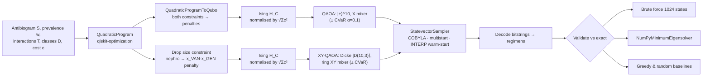
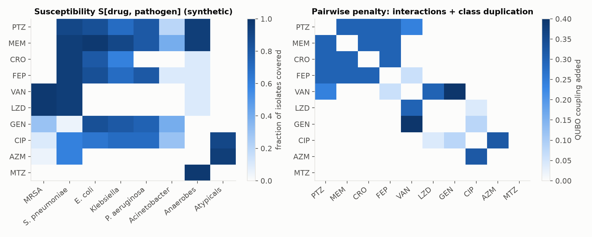
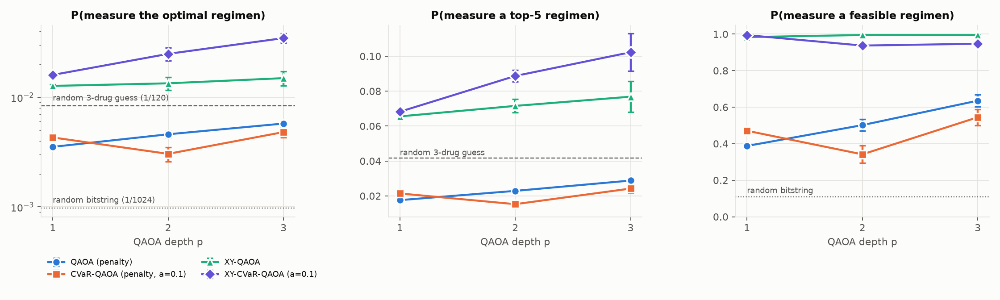
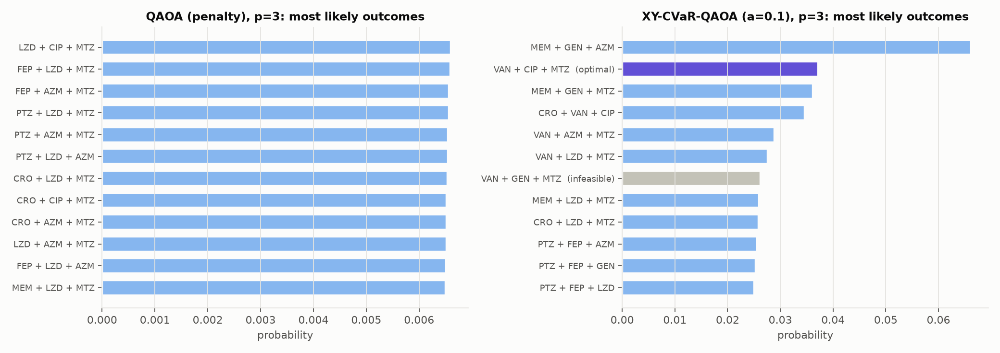
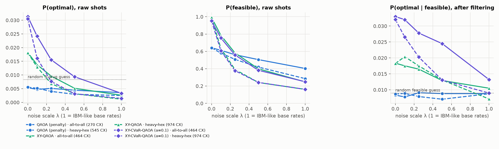

# QuantaRx: choosing antibiotic combinations with constraint-preserving QAOA

**Domain:** Healthcare · **Hackathon:** The Quantum Optimization Challenge (IBM Qiskit)

> **To run it:** see [section 5](#5-how-to-run-it). It runs locally on a simulator, needs no IBM account, and the tests take about 30 seconds.

> ⚠️ All drug and pathogen numbers in this repository are **synthetic and only loosely based on the literature**. They are not a real antibiogram, and nothing here is clinical advice. The project demonstrates an *optimization method*. It is not a prescribing tool.

---

## 1. Problem statement

When a patient arrives with severe sepsis, clinicians often have to start **empiric** antibiotics, before lab results identify the pathogen. A combination of drugs should:

* **cover** the pathogens most likely to be present, as given by the local *antibiogram* (the hospital's table of how often each drug works against each pathogen),
* avoid **harmful drug–drug interactions**, such as vancomycin + aminoglycoside (kidney toxicity) or fluoroquinolone + macrolide (QT prolongation),
* avoid **giving two drugs from the same class** (for example two β-lactams), which adds toxicity and resistance pressure for little extra coverage,
* respect **antimicrobial stewardship**: hold reserve agents such as carbapenems back where possible.

**Intended users:** hospital antimicrobial-stewardship teams who write *empiric-therapy guidelines* for a ward or setting (ICU, community pneumonia). This is a planning problem that is solved once per setting, not once per patient.

Why it is hard: coverage, redundancy and toxicity are all **pairwise effects between drugs**. The value of a drug depends on which other drugs are in the regimen, so the objective is quadratic and sums of independent scores do not capture it. With 10 candidate drugs a **greedy** heuristic already fails: it picks PTZ + LZD + GEN instead of the optimum VAN + CIP + MTZ.

## 2. Formulation

**Decision variables:** $x_d \in \{0,1\}$ for 10 drugs (PTZ, MEM, CRO, FEP, VAN, LZD, GEN, CIP, AZM, MTZ). This gives **10 qubits**.

**Data:** susceptibility $S_{dj}$ (the fraction of isolates of pathogen *j* that drug *d* kills), pathogen prevalence $w_j$ for each setting, interaction severity $T_{de}$, same-class indicator $D_{de}$, and stewardship cost $c_d$.

**True coverage is non-linear.** The weighted coverage is $\sum_j w_j\,[1-\prod_{d}(1-S_{dj})^{x_d}]$.
Truncating inclusion–exclusion at second order gives a QUBO:

$$\text{cov}_j(x) \approx \sum_d S_{dj}x_d \;-\; \sum_{d<e} S_{dj}S_{ej}\,x_dx_e$$

The quadratic term is exactly the **redundancy** of two drugs that cover the same pathogen. The approximation is a provable lower bound (a Bonferroni inequality); this is checked in `tests/`.

**Objective (minimize):**

$$
f(x) = -\alpha\sum_j w_j\Big[\sum_d S_{dj}x_d-\!\sum_{d<e}\!S_{dj}S_{ej}x_dx_e\Big]
+\beta\!\sum_{d<e}\!T_{de}x_dx_e+\delta\!\sum_{d<e}\!D_{de}x_dx_e+\gamma\sum_d c_dx_d
$$

with $\alpha=1.5,\ \beta=0.4,\ \delta=0.3,\ \gamma=1$.

**Constraints:**

| Constraint | Meaning | How it is handled |
|---|---|---|
| $\sum_d x_d = 3$ | exactly 3 drugs in the regimen | penalty $P(\sum x-3)^2$ in standard QAOA; **enforced by the circuit itself** in XY-QAOA |
| $x_{VAN}+x_{GEN}\le 1$ | at most one nephrotoxic (kidney-toxic) drug | becomes the slack-free penalty $P\,x_{VAN}x_{GEN}$ |

**Test instance:** 10 drugs × 8 pathogens with two prevalence settings, *ICU sepsis* and *community-acquired pneumonia*. There are $2^{10}=1024$ assignments, of which 112 are feasible. Every one can be enumerated, so every quantum result can be checked against the exact answer.

## 3. Quantum approach and justification



**Why QAOA:** the problem is a native QUBO/Ising model, because every interaction is pairwise. The cost unitary $e^{-i\gamma H_C}$ therefore needs only RZ and RZZ gates, which makes QAOA the natural gate-model algorithm for it.

**The extension: constraint-preserving XY-QAOA.** Standard QAOA searches all $2^{10}$ bitstrings and relies on a large penalty to keep the size constraint. That penalty dominates the energy landscape and drowns out the clinically meaningful differences between regimens. Instead we:

1. **Prepare the Dicke state** $|D^{10}_3\rangle$, an equal superposition of all 120 three-drug regimens. The circuit is our own implementation of the Bärtschi–Eidenbenz construction, using $O(nk)$ gates (186 CX instead of 1013 for generic state preparation).
2. **Use a ring XY mixer.** It applies $e^{-i\beta(XX+YY)/2}$ to neighbouring qubits, which swaps one drug for another and *never* changes how many are selected.

The circuit therefore stays inside the feasible subspace: tests show leakage below $10^{-9}$ for any angles. Only the small nephrotoxicity penalty is left.

**Further techniques:**

* **CVaR aggregation** (Barkoutsos et al., 2020): optimizes the best 10% of shots instead of the average, which favours concentrating probability on the optimum.
* **INTERP warm start** (Zhou et al., 2020): the optimized depth-p angles, interpolated to one more layer, initialize depth p+1.
* **Scale-free Hamiltonian normalization:** $H/\sqrt{\sum c_i^2}$. This is the standard deviation of the energy over uniform bitstrings, computed from the coefficients alone, so it scales to large *n* without enumerating states.
* A **pre-transpiled ansatz** with a pass manager, about 10× faster simulation.

## 4. Results

All probabilities are **exact Born probabilities at the optimized angles**: the angles are trained with a shot-based `StatevectorSampler` at 16,384 shots, then the final state is evaluated exactly. Values are the mean ± std over 3 seeds. The full tables are in [results/summary.md](results/summary.md).



### 4.1 Exact / classical reference (ICU sepsis)

| Method | Regimen | Objective |
|---|---|---|
| Brute force (all 1024 states) | **VAN + CIP + MTZ** | −0.9228 |
| `NumPyMinimumEigensolver` on the penalized QUBO | **VAN + CIP + MTZ** | same, which confirms the penalty is valid |
| Optimum of the *exact non-linear* coverage objective | **VAN + CIP + MTZ** | the QUBO approximation picks the right answer |
| Greedy heuristic | PTZ + LZD + GEN | −0.8899 (rank 3, sub-optimal) |

The model makes clinically interpretable trade-offs on its own. None of the top 10 regimens pairs vancomycin with piperacillin-tazobactam (the combination with a documented higher kidney-injury signal) or combines two β-lactams. Meropenem, a reserve agent, first appears only at rank 9.

### 4.2 Quantum benchmark



| Method | p | P(optimal) | P(top-5) | P(feasible) | Approx. ratio* | CX |
|---|---|---|---|---|---|---|
| QAOA (penalty) | 3 | 0.0058 ± 0.0002 | 0.029 | 0.635 | 0.752 | 270 |
| CVaR-QAOA (penalty) | 3 | 0.0048 ± 0.0005 | 0.024 | 0.545 | 0.749 | 270 |
| XY-QAOA | 3 | 0.0149 ± 0.0022 | 0.077 | **0.995** | **0.871** | 498 |
| **XY-CVaR-QAOA** | 3 | **0.0346 ± 0.0034** | **0.102** | 0.947 | 0.769 | 498 |
| *Random bitstring* | – | 0.0010 | 0.005 | 0.109 | – | – |
| *Random 3-drug regimen* | – | 0.0083 | 0.042 | 0.933 | 0.747 | – |

\*Expected normalized quality of the feasible samples: 1 = optimal regimen, 0 = worst feasible regimen.

**Key findings**

1. **Penalty QAOA learns feasibility but not quality.** Its feasibility rises from 11% to 64%, yet among the feasible samples it is no better than random (approximation ratio 0.75 against 0.747), and P(opt) stays below a random 3-drug guess. Its output distribution is almost flat (left panel below). The size penalty dominates the energy landscape, so the differences between regimens that matter clinically are invisible to a shallow circuit. Changing the penalty weight by 30× does not fix this (`fig_penalty.png`).
2. **Constraint-preserving XY-QAOA fixes the root cause.** Feasibility is 95–99.5% by construction, with the remaining 0.5–5% due only to the nephrotoxicity pair. P(opt) grows with depth. XY-CVaR-QAOA at p = 3 measures the optimum **6× more often than penalty QAOA, 4.2× more often than random guessing over 3-drug regimens, and 35× more often than random bitstrings.**
3. **Different objectives suit different goals.** Plain XY-QAOA gives the best *average* quality (approximation ratio 0.87), while CVaR concentrates more probability on the *best* regimens (P(top-5) = 0.10). For a stewardship team that reviews the shortlist, CVaR's shortlist is the more useful output.
4. **Second scenario (community pneumonia):** the exact optimum is CRO + AZM + MTZ, and XY-CVaR-QAOA at p = 3 reaches P(opt) = **0.085 (10× random guessing over 3-drug regimens)** with 98% feasibility. Note that ceftriaxone + azithromycin is the backbone recommended by guidelines.



### 4.3 How good is the QUBO approximation?

The second-order coverage term is exact for single drugs and a lower bound in general. Sweeping the coverage weight α shows that the QUBO optimum equals the true non-linear optimum for **α ≤ 1.5** (we use 1.5). For α ≥ 1.75 the truncation starts to matter and the two optima differ. This is reported, not hidden; see `results/summary.md`.

### 4.4 Noise and hardware study (Qiskit Aer)

`noise_study.py` takes the optimized depth-3 circuits (seed 0) and evaluates them on a simulated noisy device:

* **Connectivity:** each circuit is routed onto an **IBM heavy-hex** coupling map (`CouplingMap.from_heavy_hex(3)`), as well as onto ideal all-to-all connectivity, so the SWAP overhead is counted.
* **Noise:** depolarizing gate errors plus readout error at roughly IBM Eagle/Heron median rates (2-qubit 7.5e-3, 1-qubit 2.5e-4, readout 1.5e-2), scaled by **λ ∈ {0, 0.1, 0.25, 0.5, 1}**. λ = 1 is today's hardware; λ = 0.1 is hardware 10× better.
* **Error mitigation by symmetry verification:** a correct XY-QAOA circuit *always* outputs exactly 3 drugs. A shot with any other count is therefore a **detected hardware error** and can be discarded, at no extra quantum cost.
* **Sanity check:** at λ = 0, Aer reproduces the ideal P(opt) within shot noise (0.031 against 0.030), which confirms that the circuits were rebuilt correctly.



| XY-CVaR-QAOA, p = 3 | CX | λ = 0 | λ = 0.1 | λ = 0.25 | λ = 0.5 | λ = 1 |
|---|---|---|---|---|---|---|
| all-to-all: raw P(opt) | 464 | 0.031 | 0.024 | 0.016 | 0.009 | 0.003 |
| all-to-all: P(opt) after symmetry check | | 0.033 | 0.032 | 0.028 | 0.024 | **0.013** |
| heavy-hex: raw P(opt) | 974 | 0.031 | 0.016 | 0.008 | 0.003 | 0.001 |
| heavy-hex: P(opt) after symmetry check | | 0.032 | 0.027 | 0.020 | 0.013 | 0.009 |
| *share of shots kept (heavy-hex)* | | 100% | 64% | 40% | 25% | 17% |

Random guessing among feasible regimens gives P(opt) = 1/112 = 0.0089.

**What the noise study shows**

1. **Routing roughly doubles the circuit.** The ring XY mixer and the Dicke preparation do not fit heavy-hex connectivity, so the CX count goes from 464 to 974. Connectivity, not qubit count, is the bottleneck.
2. **Symmetry verification is the XY design's second payoff.** Fixing the size constraint in the circuit makes errors *detectable*. At λ = 0.25 on heavy-hex, post-selection raises P(opt) from 0.008 to 0.020 (2.7×) while keeping 40% of the shots.
3. **Where the advantage ends:**
   * At today's error rates with heavy-hex routing (λ = 1), even the post-selected result (0.009) only matches random feasible guessing. **The method is not useful on current IBM hardware at this depth.**
   * It stays clearly above random up to **λ ≈ 0.5 on heavy-hex**, which needs 2× better gates.
   * It also stays clearly above random on **all-to-all hardware at today's error rates** (0.013 against 0.009); trapped-ion devices offer that connectivity.
4. **Penalty QAOA carries no signal under any noise level.** Its P(opt | feasible) stays at the random value (about 0.0085) throughout, consistent with finding 1 in section 4.2.

## 5. How to run it

Everything runs locally on a classical simulator. You don't need an IBM Quantum account, an API key or a GPU. All results and figures quoted in this README are already committed in `results/`, so running anything is optional.

### Requirements

* Python 3.10–3.13 (tested on Python 3.13.0, Windows 11)
* About 1.5 GB of disk space for the packages
* Exact package versions are pinned in `requirements.txt`: Qiskit 2.6.2, qiskit-optimization 0.7.0, qiskit-aer 0.18.2

### Setup

The setup takes 2–5 minutes. Steps 1–3 are the same on every OS:

1. `git clone https://github.com/naumanzafarprofessional-creator/quantarx-qaoa.git`
2. `cd quantarx-qaoa`
3. Create a virtual environment, activate it, and install the packages with the commands for your OS below.

**Windows (PowerShell)**

```powershell
python -m venv C:\venvs\quantarx
C:\venvs\quantarx\Scripts\Activate.ps1
pip install -r requirements.txt
```

This puts the environment in a short path, `C:\venvs\quantarx`. If PowerShell blocks the activation script, run `Set-ExecutionPolicy -Scope Process Bypass` first.

**Linux / macOS**

```bash
python3 -m venv .venv
source .venv/bin/activate
pip install -r requirements.txt
```

### Run

Run these from the repository folder.

| Command | Time | What it does | Output |
|---|---|---|---|
| `python -m pytest -q tests` | ~30 s | Runs 8 correctness checks, and should report `8 passed`. They check that the QUBO's ground state is the true best regimen, that the Dicke state is exact, and that the XY mixer never changes the number of drugs. | console |
| `python run_experiments.py --quick` | ~3 min | Runs a short demo: the classical baselines, then all four quantum methods with 1 seed and up to 2 layers. | `results_quick/` |
| `python run_experiments.py` | 15–20 min (8 cores) | Runs the full benchmark behind section 4: 3 seeds, up to 3 layers, the penalty sweep, and the second scenario. | `results/` |
| `python noise_study.py` | ~3 min | Runs the noisy Aer simulation and heavy-hex routing study behind section 4.4. It reads the optimised angles in `results/results.json`, which is already committed. | `results/noise_results.json`, `results/fig_noise.png` |

The quick demo prints the exact optimum and the greedy pick first. It then prints one line per QAOA run, giving `P(opt)` (probability of sampling the best regimen) and `P(feas)` (probability of a valid regimen). The XY methods should show `P(feas)` close to 1, while penalty QAOA stays around 0.6. Quick mode writes to its own folder, so the committed full results are never overwritten.

All randomness is seeded: sampler seeds, COBYLA starting points and the transpiler. Re-running gives the same numbers on the same platform. `results/results.json` holds, for every run:

* its metrics
* the optimizer history
* the optimal angles
* the 20 most likely bitstrings

### Troubleshooting

* **`DLL load failed … filename or extension is too long` on Windows.** `qiskit-aer` can't load from a virtual environment in a very long folder path. Create the environment in a short path, as in the Windows setup above.
* **`ModuleNotFoundError: drugcombo`.** Run the commands from the repository root, and make sure the virtual environment is activated.
* **Slow runs.** The benchmark uses all CPU cores but one. On machines with fewer cores the full run takes longer. For a fast check, use `--quick`.

| File | Purpose |
|---|---|
| `drugcombo/data.py` | synthetic antibiogram, interactions, scenarios |
| `drugcombo/formulation.py` | QuadraticProgram, QUBO conversion, true vs. approximate objective, brute force |
| `drugcombo/dicke.py` | O(nk) Dicke-state circuit |
| `drugcombo/solvers.py` | penalty QAOA, CVaR, XY-QAOA, INTERP, classical baselines |
| `run_experiments.py`, `plots.py` | benchmark and figures |
| `noise_study.py` | Aer noise model, heavy-hex routing, symmetry-verification post-selection |
| `tests/test_model.py` | penalty validity, Dicke fidelity, subspace preservation, Bonferroni bound |

## 6. Limitations and honest reflection

* **No quantum advantage is claimed.** With 1024 states, brute force takes milliseconds. The small instance exists so that every quantum result can be verified exactly; the contribution is the modeling and the constraint-aware circuit design.
* **The single most likely bitstring is not always the optimum.** In the best XY-CVaR run the optimum is the *second* most likely outcome, and the most likely is MEM + GEN + AZM, which is not in the top 5. In practice you would sample many shots and keep the best one by objective; a classical check is cheap. This is the standard way to use QAOA, and we report it as such.
* **Shallow circuits only.** At p ≤ 3, P(opt) is 3.5%. Higher depth helps but costs simulation time, and on hardware it costs fidelity.
* **Hardware cost.** XY-QAOA at p = 3 needs 464 CX gates with all-to-all connectivity and 974 on heavy-hex. In the noise study (section 4.4), its advantage disappears at today's IBM-like error rates on heavy-hex, even with symmetry verification. The noise model covers only depolarizing gate errors and readout errors; it omits T1/T2 relaxation, crosstalk and coherent errors, so real hardware would likely perform worse. The angles were trained without noise; training under noise and adding zero-noise extrapolation are natural next steps.
* **Optimizer sensitivity.** Results depend on initialization. We mitigate this with seeded multi-start and INTERP warm starts, and report the std over seeds.
* **Second-order coverage approximation.** It is valid in the regime we use (verified), but it degrades when coverage dominates (α ≥ 1.75). Higher-order terms would need HUBO (higher-order binary optimization) or extra qubits.
* **Modeling simplifications:** the data is synthetic; regimen size is fixed; dose, route, allergies, renal function, local resistance trends and patient-specific factors are not modeled. This is a demonstration of method, **not clinical decision support**.
* **Scaling:** a 30-drug formulary picking 4 drugs means 30 qubits and C(30,4) = 27,405 regimens. The Dicke circuit and XY mixer scale polynomially, and the Hamiltonian normalization uses only coefficients. Simulation, however, becomes the bottleneck beyond about 25 qubits.
